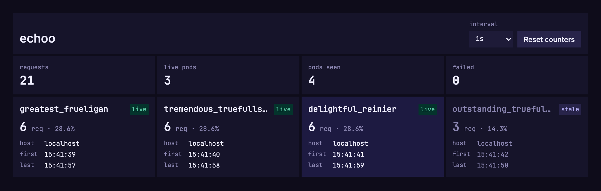

# echoo

echoo shows which backend pods answer your requests, live in the browser.

The page polls `/api` on a fixed interval. Each backend process replies with a
random name (for example `stellar_rio`) and its hostname. Every backend gets a
tile with its request count, share of traffic, first and last answer, and a
live or stale status. A tile flashes each time its pod answers.



## What it's for

- **Kubernetes rolling updates.** Start a rollout and watch new pods appear,
  old pods go stale, and traffic move across. Failed requests get their own
  tile, so you can see right away if a rollout drops traffic.
- **Load balancing.** See how evenly a Service, Ingress or Gateway spreads
  requests across replicas, and what changes when you turn on session
  affinity.
- **Cross-region connectivity demos.** Run echoo in several clusters or regions
  behind a global load balancer or multi-cluster service mesh. The hostname
  on each tile shows which region served the request. Take a region down and
  watch the failover.

A pod counts as stale when it hasn't answered for 4 polling rounds per active
pod (at least 5 rounds and 5 seconds). With 3 pods at a 1s interval that's 12
seconds, with 10 pods 40 seconds. Requests are spread at random, so a healthy
pod can miss a few in a row; this threshold keeps false "stale" marks under
2% whatever the number of pods. A stale pod is usually one that was terminated
or removed from the endpoints. Pausing freezes the status.

## Run it

Images for `linux/amd64` and `linux/arm64` are published to GHCR:

```bash
docker run --rm -p 3000:3000 ghcr.io/gnur/echoo:latest
```

### On Kubernetes

[`manifests/`](manifests) has a ready-to-use example in the `echoo` namespace:
three echoo replicas behind a Service, and an nginx proxy in front of that
Service.

```bash
kubectl apply -k manifests
kubectl -n echoo rollout status deployment/echoo
kubectl -n echoo port-forward service/nginx 8080:80
```

Open http://localhost:8080 and you'll see a tile for each of the three pods.
Trigger a rollout in another terminal and watch the old pods go stale as the
new ones take over:

```bash
kubectl -n echoo rollout restart deployment/echoo
```

Why the nginx proxy? `kubectl port-forward` to a Service tunnels to a single
pod, so you'd only ever see one tile. nginx opens a new connection to the echoo
Service for every request, so kube-proxy spreads the requests over all pods. In
a real setup an Ingress, Gateway or `LoadBalancer` Service does the same job.

Clean up with `kubectl delete -k manifests`.

### Endpoints

| Path       | Returns                                              |
| ---------- | ---------------------------------------------------- |
| `/`        | The dashboard                                        |
| `/api`     | `{ name, hostname, boot, timestamp }` for this process |
| `/healthz` | `{ "status": "ok" }`, for liveness and readiness probes |

### Configuration

| Variable             | Default | Effect |
| -------------------- | ------- | ------ |
| `NUXT_MASK_HOSTNAME` | `true`  | Hostnames that don't look like a Kubernetes pod name (`echoo-7d9f8b6c5-x2k4p`, `echoo-0`) are reported as `localhost`, so laptop or VM names don't end up in demos and screenshots. Set to `false` to always show the real hostname, for example when running on VMs in a cross-region demo. |
| `PORT`               | `3000`  | Port to listen on. |

## Development

Requires [bun](https://bun.sh).

```bash
bun install
bun run dev      # http://localhost:3000
bun run build    # production build in .output/
bun run preview  # serve the production build
```

The UI follows the [design guidelines](https://dekeijzer.xyz/style-guide.md);
all values come from `app/assets/css/design-tokens.css`.

## Releases

Every push to `main` builds the multi-arch image and creates a GitHub release.
Releases are numbered `v<N>`, one higher than the latest `v*` tag (`v6.1` →
`v7` → `v8`). Each image is tagged with the release number, `latest` and the
commit SHA. Pull requests build the image without pushing it.
